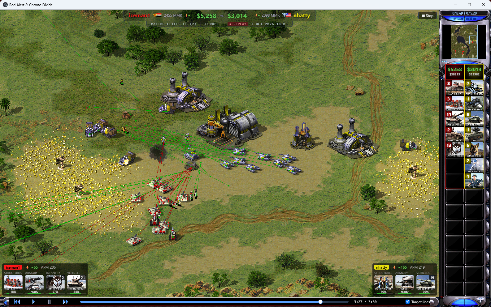
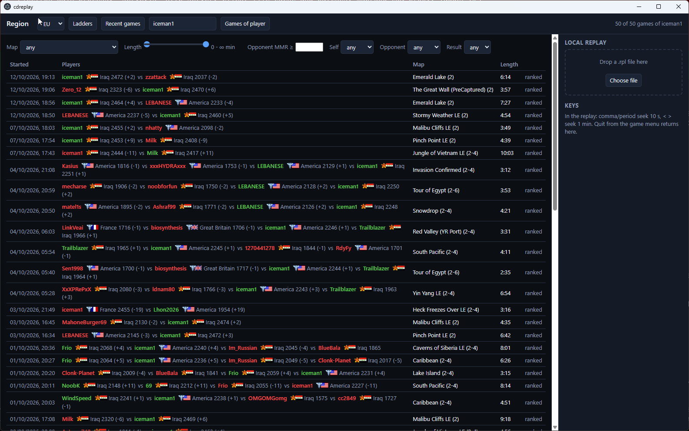

# cdreplay

A standalone replay viewer for **[Chrono Divide](https://chronodivide.com)**, the browser remake of Red Alert 2.
Everything here is built on top of the Chrono Divide client: cdreplay runs the real game client in an Electron window
and adds a seek bar and observer overlays on top of it. All rendering and simulation is Chrono Divide's own.



## Features

- **Seek bar**: jump anywhere in a replay, forwards and backwards, media-player style. Backward seeks use keyframes
  (extra game instances parked at intervals), so a jump takes about a second.
- **Unit counters**: per player, in the sidebar, with the game's own cameos: miners, war factories, tanks, dogs, and
  whatever else is on the field, plus credits and total spent. Heavily influenced by the stream overlay of
  [doof88](https://www.twitch.tv/doof88).
- **Production queues**: what each player is building in every queue, with cameos and progress. Also after doof88's
  overlay.
- **Target lines**: the game's target lines for every unit of every player, flashing on new orders.
- **APM tracker**: actions per minute per player, live and as a graph on the end screen.
- Also: a match header (MMR, power, credits, map, region, date) mimicking the one on
  [RA2CastTV](https://www.twitch.tv/ra2casttv)'s casts, health bars for all units, the owner's current
  selection, an end screen with units built/lost/killed and graphs of credits earned, army value and APM, team games
  grouped by alliance.
- **Game browser**: ladder standings, recent games per ladder, a player's games with filters (map, length, opponent
  MMR, factions, result), drag-and-drop of local `.rpl` files. Switching replays takes about a second.



## Install

1. Download `cdreplay.exe` from the [latest release](../../releases/latest). It is portable: no installer, and
   unsigned, so SmartScreen warns once.
2. Run it. The client asks for the Red Alert 2 game files once; choose "browse folder" and pick your RA2 install.
   Everything is kept in `%LOCALAPPDATA%\cdreplay`.
3. Optional: open replay links from the ladder site directly in the app with the browser extension. Chrome:
   `chrome://extensions`, developer mode, "Load unpacked", pick the `chrome-extension` folder of this repository.
   Chrome cannot install an extension file outside the Web Store, so the release's `cdreplay-chrome-*.zip` is the same
   folder to extract and load unpacked. Firefox: install the signed `.xpi` from the release. Append `&web` to a replay
   link to get the web client instead.

Keys in a replay: space pause, comma/period seek 10 s, `<` `>` seek 1 min, F12 developer tools (`window.cdr`).

## Credits

- [Chrono Divide](https://chronodivide.com) by its author, which this tool is entirely built on. cdreplay is not
  affiliated with Chrono Divide; it downloads the official client on first run and patches it in memory. Nothing of
  Chrono Divide or Red Alert 2 is included in this repository or in the builds.
- The match header is mimicked from the Twitch channel [RA2CastTV](https://www.twitch.tv/ra2casttv); the unit
  counters and production queues are heavily influenced by [doof88](https://www.twitch.tv/doof88)'s stream overlay.
- Programmed by Claude (Anthropic), directed by Frank Razenberg.

## From source

```
npm install
npm start -- [file.rpl | ladder replay url | game id]     game browser, or that replay
npm run dist                                              dist\cdreplay.exe
npm run ext:lint / npm run ext:sign                       Mozilla validator / sign the Firefox add-on (credentials in
                                                          web-ext-config.cjs, see web-ext docs)
```

`cdreplay.bat` launches it from a working copy, with the same optional argument. `npm run dist:offline` adds a
snapshot of the cached client to the exe for a machine without network access; do not distribute that build, the
client is proprietary.

## How it works

`serve.js` is a small http server: it mirrors the client files from game.chronodivide.com into the cache (per version),
injects `cdreplay.js` into `index.html`, proxies maps, mods and the ladder API under the same origin, and serves replay
files. `cdreplay.js` hooks the client's modules by their SystemJS names (`gui/screen/replay/ReplayScreen`,
`network/gamestate/ReplayTurnManager`, `game/Game`, ...) and patches prototypes. `main.js` is the Electron shell,
`browser.html` the game browser.

The engine cannot snapshot its state (task callbacks are closures over live objects), which is why keyframes are
simulated copies rather than saved states. Client patches: no pointer lock and no edge scrolling (the OS cursor works on
the overlays), the viewport always fills the window, the splash delay is skipped, and detect-gpu's fallback for cards
newer than its list no longer reports "unsupported".

A client update can break the hooks; the page reports errors to `cache/client.log`. Replays of older engine versions go
through the official `/old/` client builds, like the web client does.

## CI

`.gitlab-ci.yml` (checks on push, Windows build and release on tags, manual Firefox signing) and
`.github/workflows/release.yml` (build and release on tags). `ci/gitlab-runner/` holds a compose file for a
docker-executor GitLab runner.
